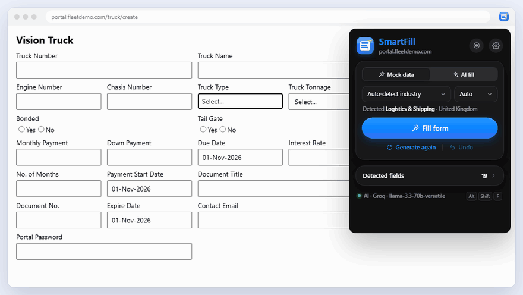
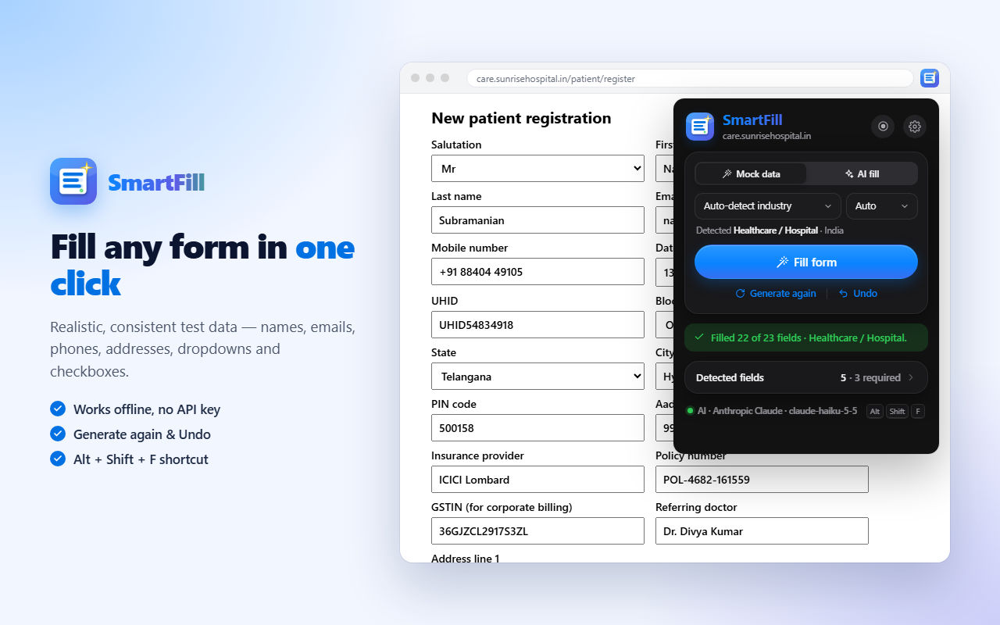
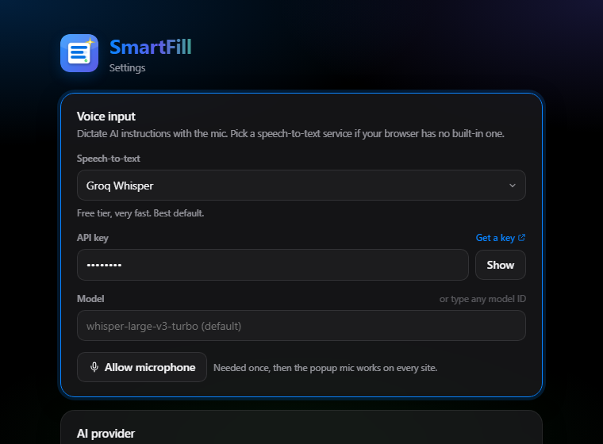

<p align="center">
  
</p>

<h1 align="center">SmartFill</h1>

<p align="center">
  <strong>Fill any web form in one click.</strong><br>
  Realistic test data for 20 industries, or smart values from the AI you choose.
</p>

<p align="center">
  <a href="https://chromewebstore.google.com/detail/smartfill-lite-ai-form-fi/gcfnhnhofhponjlaanblhnbakpbmdmol">
    
  </a>
</p>

<p align="center">
  
</p>

---

## What it does

Testing a form by hand means typing the same name, email and phone again
and again. SmartFill does it for you.

1. Open any page with a form.
2. Click the SmartFill icon.
3. Press **Fill form**.

Every field is filled: text boxes, dropdowns, radio buttons, checkboxes and
dates. Click **Generate again** for new values, or **Undo** to put the page
back exactly as it was.

SmartFill only touches form fields. It never clicks buttons, links or menus,
and it leaves page controls alone: theme and dark-mode switches, back
buttons, language and sort pickers, accordions and table row checkboxes.

## Pick the form once, SmartFill remembers it

Pages often have more than one form, or widgets next to the form. Choose
exactly what gets filled:

1. In the popup, click **Select form area**.
2. On the page, click a form, or drag a box over the fields you want.
   Shift+click a field to add or remove it. ↑ / ↓ widens or narrows the area.
3. Press **Save & fill** (or **Save area**).

Next time you open that page, SmartFill finds the same form by its field
labels. If 85% or more of them match, it says **Auto-scanned from your last
visit** and fills only that area. You choose:

- **Fill same values:** continue with the values from last time.
- **New values:** generate fresh ones.
- **Rescan** to pick the area again, or **Whole page** to ignore it once.

Saved forms are listed under **Settings → Saved forms**, where you can
delete them or turn the feature off. Passwords, card numbers and ID numbers
are never saved.

## Two ways to fill

| | **Mock data** | **AI fill** |
| --- | --- | --- |
| How it works | Makes up realistic values on your computer | Asks the AI provider you picked |
| Needs | Nothing. Works offline | Your own API key |
| Speed | Instant | A few seconds |
| Best for | Everyday testing | Unusual forms, or when you want to describe the person |

AI fill never leaves a gap: if the AI skips a field, mock data fills it.

<p align="center">
  
</p>

## Smart about every field

SmartFill reads the label you see on the page, not just the hidden field
name. So "Monthly Payment" gets an amount, "Interest Rate" gets a percent
and "Truck Name" gets a truck model, even when the page's code is messy.

- **One person per fill.** The name, email, phone and address all match.
- **Real formats.** GSTIN, PAN, IFSC, Aadhaar, SSN, NPI, VIN, IBAN, AWB and
  more look valid and pass their checksums. They are still fake.
- **Dates match the page.** If the page shows `01-Nov-2026`, SmartFill writes
  dates the same way.
- **Region aware.** India, US or UK phone numbers, postcodes and date styles.
  Auto picks one from the website and its fields.

### 20 industries

Leave it on **Auto** and SmartFill guesses the industry from the page. Or
pick one yourself; your choice is remembered.

General · Healthcare · CRM / Sales · Logistics · Government · Banking ·
Insurance · E-commerce · HR & Jobs · Education · Real Estate · Travel ·
Legal · Pharmacy & Lab · Manufacturing · SaaS Sign-up · Restaurant ·
Automotive · Telecom & Utilities · Events & Non-profit

## Your own login details

Developers sign up with the same details again and again. In
**Settings → Login details** you can set:

- **Password:** one fixed password for every form. Leave it empty for a new
  strong password each time.
- **Email**, three choices:
  - **Random:** a made-up `example.com` address.
  - **My emails:** your own addresses. Turn on **+alias** to get a new address
    each time that still lands in your inbox, like `you+k3x9a@gmail.com`.
  - **Temp inbox:** a free public inbox (Mailinator, Maildrop, YOPmail,
    InboxKitten, Guerrilla Mail). After filling, press **Open inbox** in the
    popup to read the verification email.

## AI providers

Pick any of these in **Settings → AI provider**. The model list loads by
itself, or you can type any model name. **Test connection** checks your key.

OpenAI · Anthropic Claude · Google Gemini · DeepSeek · OpenRouter · xAI Grok ·
Groq · Mistral · Together · Fireworks · Perplexity · Cerebras · Cohere ·
Alibaba Qwen · Moonshot Kimi · NVIDIA · SambaNova · Ollama Cloud ·
Ollama (local) · LM Studio (local) · any OpenAI-compatible server

You can also give the AI instructions, such as *"Senior doctor in Chennai,
use @acme.in emails"*.

## Voice input

Press the mic to speak your AI instructions instead of typing them.

Chrome and Edge turn speech into text for free. Some browsers, like
**Brave**, can't. For those, choose a speech-to-text service in
**Settings → Voice input**:

| Service | Good to know |
| --- | --- |
| Groq Whisper | Free tier, very fast. **Best place to start.** |
| Deepgram | Free credit when you sign up |
| AssemblyAI | Free credit when you sign up |
| Google Gemini | Free tier |
| ElevenLabs Scribe | Free monthly allowance, great with accents |
| Mistral Voxtral | Low cost |
| OpenAI | Paid, very accurate |
| Together AI | Paid |
| Fireworks AI | Paid |
| Custom | Your own server (LocalAI, faster-whisper-server, …) |

Voice and form filling are **separate**. For example, you can fill forms with
DeepSeek and speak through Groq. If you already saved a Groq, OpenAI, Gemini,
Mistral, Together or Fireworks key for AI fill, voice reuses it.

<p align="center">
  
</p>

## Handy extras

- **Keyboard shortcut:** `Alt` + `Shift` + `F` fills the page without opening
  the popup.
- **Keep my values:** only fill empty fields.
- **Safe Filling Mode:** leave passwords, ID numbers and card fields blank,
  and leave "I agree" boxes unticked.
- **Record & replay:** record clicks and typing on a site, then replay them.

## Privacy

- There is no SmartFill server and no tracking.
- Settings and API keys stay in your browser and are never synced.
- **Mock data** never leaves your computer.
- **AI fill** sends field labels, options and your instructions straight to
  the AI provider you picked. Values already typed on the page are never sent.
- **Voice** clips go only to the speech service you picked, and only when you
  press the mic.

---

## For developers

SmartFill is built with [Plasmo](https://www.plasmo.com/) (Chrome Manifest V3),
React and TypeScript.

```bash
# from the repository root
bun install

cd apps/smartfill-lite
bun run dev        # development build with live reload
bun run build      # production build → build/chrome-mv3-prod
bun run package    # zip for the Chrome Web Store → build/chrome-mv3-prod.zip
bun test tests/    # unit + DOM tests (happy-dom)
```

To check the production content script in a real browser, run
`bun run build && bun tests/e2e/serve.ts` and open http://localhost:4317.
The fixture page has a theme toggle, menus, a back button and tricky
dropdowns around a form; in DevTools run `await smartfill('fillForms')` and
check `window.__unexpectedClicks` stays empty. `/popup?scope=memory` shows
the built popup with a stubbed `chrome` API.

To try a build, open `chrome://extensions`, turn on **Developer mode**,
click **Load unpacked** and choose `build/chrome-mv3-prod`.

### Where things live

| Path | What it holds |
| --- | --- |
| `src/popup.tsx` | The popup: mode, industry, region, Fill, Undo |
| `src/options.tsx` | The settings page |
| `src/content.ts` | Runs on the page: finds fields, makes values, fills them |
| `src/background.ts` | All AI requests and the keyboard shortcut |
| `src/api/ai/` | AI providers, prompt and reply parsing |
| `src/api/voice/` | Speech-to-text services |
| `src/lib/detection/` | Finds fields (incl. shadow DOM) and keeps page UI out (`safety.ts`) |
| `src/lib/filling/` | Writes values; only opens real dropdowns (`role="listbox"`) |
| `src/lib/memory/` | Saved form areas and the 85% signature match |
| `src/lib/picker/` | The on-page area picker and the SmartFill card |
| `src/lib/mock/` | Mock data: field kinds, 20 industries, regions, login presets |
| `src/lib/settings.ts` | Saved settings |
| `store/` | Chrome Web Store images |
| `docs/` | README images and demo GIF |

Chrome Web Store text, permission reasons and privacy answers are in
[STORE_LISTING.md](STORE_LISTING.md).
